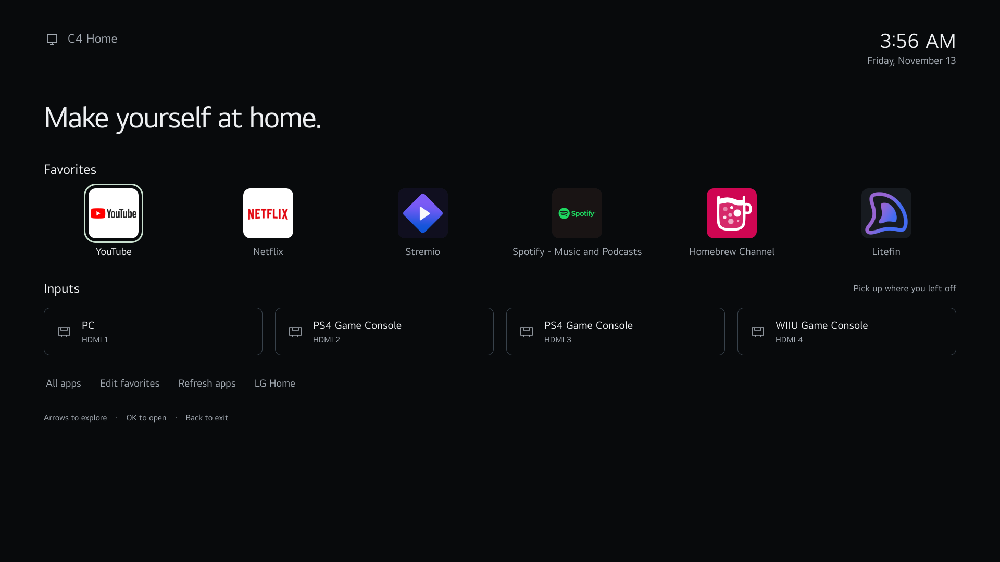

# LGTV Minimalist Launcher — C4 Home 1.0.3

Dark, minimal standalone launcher tested on an LG C4 OLED running webOS TV 10.3.1. It leaves the existing Home button and startup behavior unchanged.

## Install

Download `dist/com.lgtv.minimalistlauncher_1.0.3_all.ipk`. In webOS Dev Manager, connect to your TV, choose Install, and select the package. This personal build was tested with a rooted TV and Homebrew Channel; installation on other configurations has not been verified.

## Develop and build

Requires Node.js and npm. Run `npm install`, then `npm run package` to write an IPK into `dist/`. For browser verification, run `npx playwright install chromium`, then `npm test`. Alternatively set `CHROME_PATH` to an existing Chrome executable.

Open `app/index.html` for a desktop preview. Customize `app/catalog.js` for your own installed app IDs and HDMI labels, and the default favorites in `app/app.js`. This is a saved device-specific catalog, not automatic discovery of every app on any TV.

## Use

Open **C4 Home** in the LG app launcher. Move with the arrow keys and press OK to open an app or HDMI input. The Magic Remote pointer also works.

- **All apps** shows the 17 shortcuts captured from your TV's visible app list.
- **Edit favorites** lets you add or remove favorites. Press Back or choose Done editing to finish. Favorites save on the TV, in the order you add them.
- **Refresh apps** checks whether the saved app shortcuts are still installed. Newly installed apps require a catalog update from this computer. HDMI names are the saved names from setup.
- **LG Home** opens the normal LG interface.
- **Back** leaves editing or All apps first, then closes the launcher.

After one minute without input, the screen dims; after two minutes it fades fully to black. The first remote input wakes the screen without launching anything. This reduces static display time; it is not a guarantee against OLED burn-in.

## Files

- `dist/com.lgtv.minimalistlauncher_1.0.3_all.ipk`: reinstallable webOS package.
- `app/`: complete static HTML/CSS/JavaScript source. Open `app/index.html` on a computer for a preview; opening TV apps works only on the TV.
- `docs/screenshot.png`: actual rendering captured from the TV's app engine.

No privileged background helper was installed. The launcher uses public application-manager APIs for availability checks and app launches. Icons were copied from your existing TV apps; this is a personal build, not an asset bundle for redistribution. No TV connection credentials are included.

## Verification

Browser checks passed for favorites persistence, D-pad movement, the app list, HDMI shortcuts, and layout at 1920, 960 and 390 pixels wide. On-TV checks confirmed all-app/favorites switching, D-pad focus, and public API calls. Version 1.0.1 fixes reopening by letting webOS bring the app to the foreground automatically (`handlesRelaunch: false`). Two HDMI-to-launcher reopening checks passed, and you confirmed it works.

## Implementation references

- [LG Application Manager](https://webostv.developer.lge.com/develop/references/application-manager)
- [LG App Lifecycle Management](https://webostv.developer.lge.com/develop/guides/app-lifecycle-management)

## Modern Web Guidance

I applied `spatial-navigation`: focus candidates use current button geometry, and navigation scrolls the focused control into view. At an edge, the handler follows the rule “do not prevent default browser behavior,” preserving native scrolling. The composite launcher uses grid semantics and roving tabindex.

## Version 1.0.2

Uses the highest-resolution installed app icons (192–230 pixels where available), a vector Homebrew Channel icon, and density-aware sizing that never stretches raster icons beyond their source pixels. Smaller source icons appear smaller to stay sharp. Tile and input elements persist through refreshes and favorite edits; selection no longer moves the tile or changes its outline thickness.

## Version 1.0.3

Removes the persistent catalog status, app-count caption, and introductory subtitle. App buttons are square, with artwork filling the button edge to edge. A shared density-aware size uses a 192-pixel source budget (96 CSS pixels at 2× density, capped at 136 CSS pixels on a desktop); older 130-pixel artwork remains limited by its original resolution. Stable tile updates, saved favorites, and focus behavior are retained.
